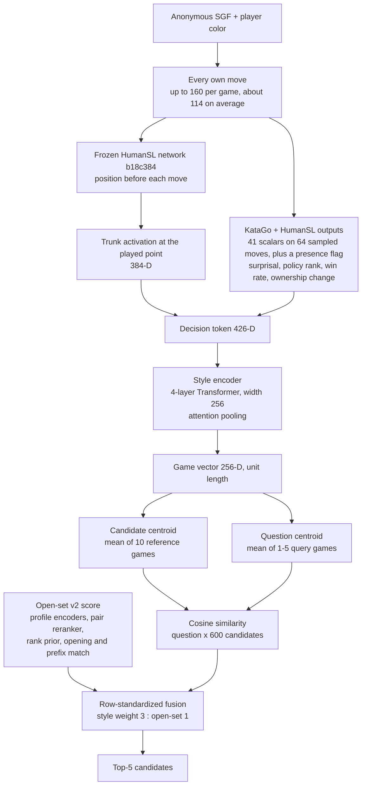
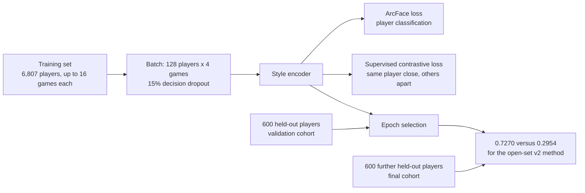
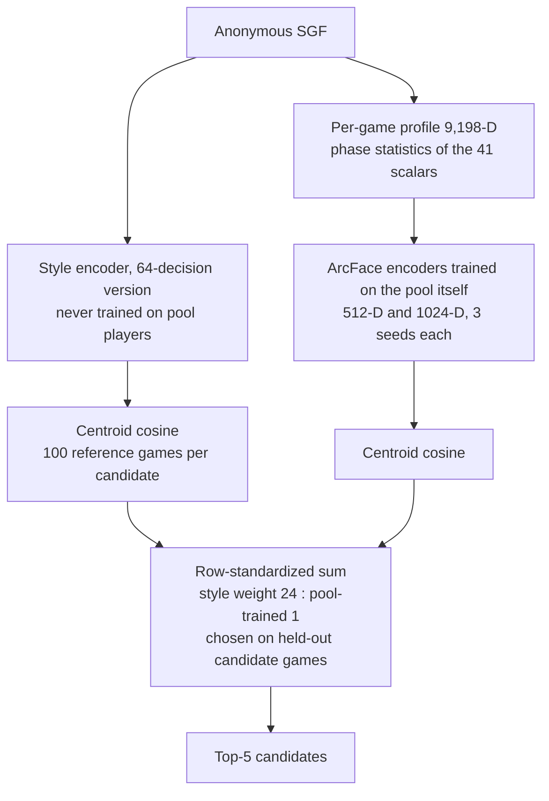

# AICUP 2026 Go Research

This monorepo keeps the two AI CUP Go tasks explicitly separated. They use
different labels, evaluation metrics, model heads, and inference protocols;
their scores must not be compared as if they were the same task.

| Directory | Task | Internal benchmarks |
| --- | --- | ---: |
| [`competition1_player_identification/`](competition1_player_identification/) | Identify players among 400/600 enrolled candidates | Historical 400-way: **0.923040**; new 600-way final cohort: **0.7270** (open-set v2: 0.295403) |
| [`competition2_rank_prediction/`](competition2_rank_prediction/) | Predict D–6D rank for unseen players | **0.7170** on a 2,000-player cross-fitted cohort (+0.041 over the previous default, pre-registered) |

These are offline proxy/holdout results under different protocols, not
official leaderboard submissions.

Competition 1's v2 **Public best is 0.8345466** (2026-11-13, per-move HumanSL
trunk style encoder reading every own move; see
[the record](competition1_player_identification/docs/public_v2_trunk_style_20261113.md)).
Earlier that day 0.5640548 was reached by fusing pool-trained and open-set
methods on all four pools (see
[the record](competition1_player_identification/docs/public_v2_openset_20261113.md)).
The previous v2 Public best was 0.5236602, reported by the user on
2026-11-11. Frozen original-pool encoders improved on the candidate-retrained
submission's 0.4650701 (+0.0585901). The v2 score averages original and new
Public questions and is not comparable to the historical 0.923040 proxy.
See the [official submission record](competition1_player_identification/docs/public_v2_20261111.md).

Competition 2's 2026-11-06 submission received **0.7227214 Public**,
reported by the user. Its Private score is not yet available. The exact
submission record is in
[`competition2_rank_prediction/docs/public_submission_20261030.md`](competition2_rank_prediction/docs/public_submission_20261030.md).

The initial static-analysis baseline and known legacy debt are recorded in
[`QUALITY.md`](QUALITY.md).

## Current best architecture: player identification (Public 0.8345466)

The submission answers the two kinds of pools with different pipelines,
because the reference library per candidate differs tenfold (100 games
versus 10). Details and offline numbers:
[trunk style encoder record](competition1_player_identification/docs/public_v2_trunk_style_20261113.md).

### New pools (600 candidates x 10 games, 1-5 query games, mixed colors)



Training of the style encoder (no official test player is used):



### Original pools (400 candidates x 100 games, 5-20 query games, black only)



## Competition 1: player identification

The original candidate library contains 100 reference games per player;
v2 adds 600-player pools with ten games per player and mixed actor colors.
The research
pipeline extracts KataGo/HumanSL decision profiles, ownership-spatial features,
and ArcFace game embeddings, then performs cosine retrieval followed by a
group-softmax Top-20 reranker.
The [completed new-task experiment](competition1_player_identification/experiments/open_set_v2/RESULTS.md)
trained open-set encoders on 6,807 training players and evaluated on a separate
600-player final pool: **0.295403**, versus the fixed Fisher-profile baseline
**0.057627**. It uses ten references and 1/2/3/5-game queries, with learned
local game matching, opening cues and a clean C2-derived rank prior. It has
not replaced the official Public-best submission.

For the v2 submission, original-pool encoders and normalization are frozen
when embedding the new candidate/query pools; neural weights are not refit
on their ten-game libraries.

Read
[`competition1_player_identification/README.md`](competition1_player_identification/README.md)
for the exact method and reproduction commands.

## Competition 2: rank prediction

The model must generalize to unseen players and predict one of ten ordered
ranks. The current default (2026-10-21) combines dense KataGo/HumanSL ordinal
models and ResNet snapshots with evidence from each game's **opponent** (an
opponent-specific Transformer) and a question-level shift residual that uses
the opponent distribution and a KataGo game-result proxy; both additions were
confirmed in a pre-registered 2,000-player cross-fitted test.

Read
[`competition2_rank_prediction/CURRENT_BEST.md`](competition2_rank_prediction/CURRENT_BEST.md)
for the authoritative score and locked evaluation protocol.

## Repository policy

This repository tracks source code, launch scripts, configuration templates,
small JSON reports, and research documentation. It intentionally excludes:

- licensed SGF/CSV competition data;
- KataGo, HumanSL, and tutorial model weights;
- trained `.pt` checkpoints and cached `.npz` embeddings;
- logs, virtual environments, generated submissions, and local archives.

Those artifacts remain on the research machine and must be restored separately
to reproduce GPU inference. Each competition directory documents its expected
local paths.

## Local machine layout

All Go-related machine-local state is consolidated below this repository:

```text
AICUP2026_GO/
├── competition1_player_identification/  # tracked task-1 source and reports
├── competition2_rank_prediction/        # tracked task-2 source and reports
├── data/                                # licensed training and official tests
├── runtime/
│   ├── competition1_research/           # venv, models, feature caches
│   ├── competition2_research/           # full historical task-2 workspace
│   └── tutorial_review/                 # official tutorial reproduction
└── production/
    ├── 20261030/                        # task-1 resumable test features
    └── rank_20261030/                   # task-2 features and submission
```

`data/`, `runtime/`, and `production/` are intentionally ignored by Git.
The official tutorial review remains accessible at the separate
`/tmp2/richard/aicup_tutorial_review` entry. The old task and data symlinks
are kept under `runtime/legacy_paths/` for reference; historical scripts and
SQLite indexes that embed the former absolute `/tmp2/richard/...` locations
may need their paths updated before they can be rerun.

## Development checks

Python changes must pass `pylint` and `mypy`. Enable the repository hook after
cloning:

```bash
git config core.hooksPath .githooks
```

The original Redmine `infra` hook document was not available in this execution
environment; `.githooks/pre-commit` implements the required staged-file
`pylint` and `mypy` checks directly.
