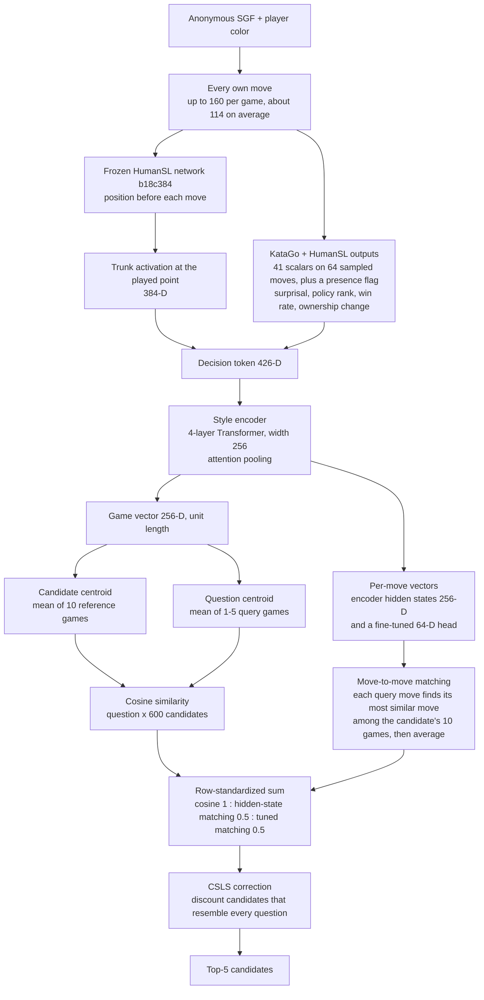
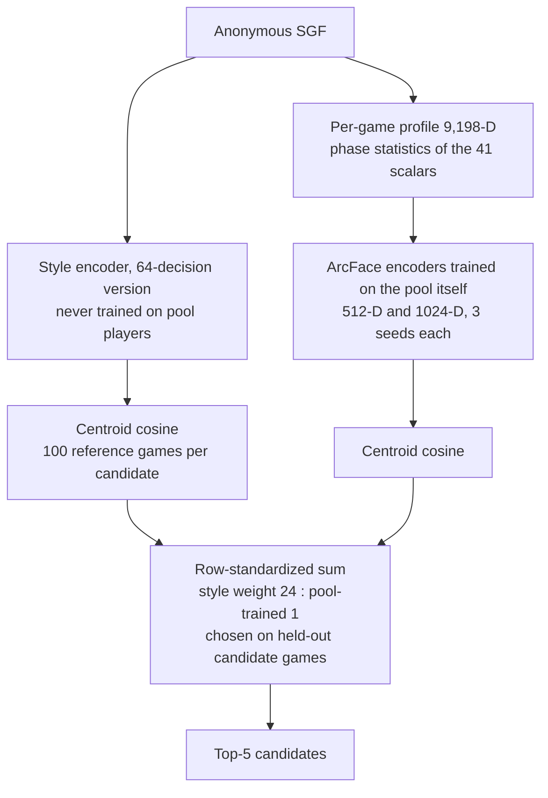

# AICUP 2026 Go Research

[中文說明](README.zh-TW.md)

This monorepo holds the research code and records for the two AI CUP 2026 Go
tasks. They use different labels, metrics, models and inference protocols, so
their scores must not be compared.

| Directory | Task | Final official Public |
| --- | --- | ---: |
| [`competition1_player_identification/`](competition1_player_identification/) | Identify the player among 400 or 600 candidates | **0.8961831** (v9) |
| [`competition2_rank_prediction/`](competition2_rank_prediction/) | Predict the registered rank (10 classes) of unseen players | **0.7599623** (v47) |

Private scores are not yet available. The two final submissions, their
weights and score files are collected in
[`final_20261125/`](final_20261125/README.md); the weights are published as
GitHub release assets, not committed.

## Score history

### Competition 1: player identification

| Date | Method | Public |
| --- | --- | ---: |
| 2026-11-11 | Original-pool encoders frozen and applied to the new pools | 0.5236602 |
| 2026-11-13 | Pool-trained and open-set methods fused | 0.5640548 |
| 2026-11-13 | Per-move HumanSL trunk activations + style encoder (v4) | 0.8592604 |
| 2026-11-14 | Listwise reranker | 0.8637413 |
| 2026-11-14 | Move-to-move matching + CSLS (v5) | 0.8801077 |
| 2026-11-14 | Same method on the original pools (v6) | 0.8819787 |
| 2026-11-15 | Second encoder on 960-D tokens, scores summed (v9, final) | **0.8961831** |

Retraining on every labelled player (v11 / v12 / v13) scored 0.8922 / 0.8833 /
0.8906; retraining alone moves the Public score by about ±0.01, so v9 stays.

### Competition 2: rank prediction

| Date | Method | Public |
| --- | --- | ---: |
| 2026-11-06 | KataGo / HumanSL per-move features, ordinal Transformer, ResNet, opponent-side model (C1+C2) | 0.7227214 |
| 2026-11-14 | Evidence from recognised opponents' registered ranks (v4) | 0.7586411 |
| 2026-11-15 | Opponents recognised with two style encoders (v47, final) | **0.7599623** |

Records: [trunk style encoder](competition1_player_identification/docs/public_v2_trunk_style_20261113.md),
[opponent identity](competition2_rank_prediction/experiments/opponent_identity/RESULTS.md),
[C1+C2](competition2_rank_prediction/CURRENT_BEST.md). The initial
static-analysis baseline and known legacy debt are in [`QUALITY.md`](QUALITY.md).

## Current best architecture: player identification (Public 0.8961831)

The diagrams show one encoder (Public 0.8801077 / 0.8819787). The final
submission runs the same new-pool pipeline twice, with 384-D and with
960-D move tokens (trunk at the played point, its 3x3 neighbourhood and
residual blocks 12 and 6), and sums the six standardized scores before
CSLS; the original pools keep the single-encoder answers.

The submission answers the two kinds of pools with different pipelines,
because the reference library per candidate differs tenfold (100 games
versus 10). Details and offline numbers:
[trunk style encoder record](competition1_player_identification/docs/public_v2_trunk_style_20261113.md).

### New pools (600 candidates x 10 games, 1-5 query games, mixed colors)



Training of the style encoder (no official test player is used):


### Original pools (400 candidates x 100 games, 5-20 query games, black only)



## Competition 1: player identification

Every own move (up to 160 per game) is read by the frozen HumanSL network; the
trunk activation at the played point, with 41 engine scalars, feeds a
four-layer Transformer trained with ArcFace and supervised contrastive loss on
6,807 training players. Candidates are scored by game-vector cosine and
move-to-move matching, corrected with CSLS. The final v9 sums these scores
from two encoders (384-D and 960-D move tokens) on the new pools; the original
pools use the v6 answers. See
[the record](competition1_player_identification/docs/public_v2_trunk_style_20261113.md)
and [`competition1_player_identification/README.md`](competition1_player_identification/README.md).

## Competition 2: rank prediction

The C1+C2 pipeline (dense KataGo/HumanSL ordinal models, ResNet snapshots, an
opponent-specific Transformer and a question-level shift residual) gives the
base probabilities. The final v47 multiplies them with evidence from the
opponents: about 70% of official test opponents are labelled training
players, so the Competition 1 style encoders recognise them and their
registered ranks inform the asked player's rank. See
[`CURRENT_BEST.md`](competition2_rank_prediction/CURRENT_BEST.md) and
[the opponent identity record](competition2_rank_prediction/experiments/opponent_identity/RESULTS.md).

## Post-final audits (2026-11-17 to 11-20, all negative)

After the final submissions, nine rank-prediction audits were run on separate
branches. None changed a submission. The branches were removed on 2026-11-25;
their commits are kept under the tags below.

| Tag | Topic | Result |
| --- | --- | --- |
| [`archive/experiment-strength-score-v2`](https://github.com/richard880502/AICUP2026_GO/tree/archive/experiment-strength-score-v2) | Strength Score v2, Tier A and full training coverage | all negative |
| [`archive/experiment-rank-context-v1`](https://github.com/richard880502/AICUP2026_GO/tree/archive/experiment-rank-context-v1) | Rank context (handicap and colour channel) | the handicap channel is empty in the official test set |
| [`archive/audit-shared-opponent-recurrence`](https://github.com/richard880502/AICUP2026_GO/tree/archive/audit-shared-opponent-recurrence) | Shared unknown opponents across test players | audited before building: do not build |
| [`archive/audit-identity-matchmaking-graph`](https://github.com/richard880502/AICUP2026_GO/tree/archive/audit-identity-matchmaking-graph) | Identity / matchmaking graph, cross-encoder residual | preregistered gate fails; the identity route is closed |
| [`archive/analysis-hard-boundary-feature-atlas`](https://github.com/richard880502/AICUP2026_GO/tree/archive/analysis-hard-boundary-feature-atlas) | Hard-boundary feature atlas (1D/2D) | nothing usable against a permutation null |
| [`archive/research-rankmle`](https://github.com/richard880502/AICUP2026_GO/tree/archive/research-rankmle) | Ten HumanSL rank profiles instead of three (premise audit) | stable direction, underpowered |
| [`archive/experiment-ten-profile-production`](https://github.com/richard880502/AICUP2026_GO/tree/archive/experiment-ten-profile-production) | Ten-profile production Transformer | +0.0139 alone, but the gain does not survive C1+C2 or v47 |
| [`archive/experiment-conditional-complementarity-v1`](https://github.com/richard880502/AICUP2026_GO/tree/archive/experiment-conditional-complementarity-v1) | Ten-profile complementarity conditional on opponent confidence | screen fails, premise does not hold |
| [`archive/experiment-opponent-rank-posterior-audit`](https://github.com/richard880502/AICUP2026_GO/tree/archive/experiment-opponent-rank-posterior-audit) | Ground-truth audit of opponent identity to rank posterior | known/unknown control audit; v47 proxy not deployable |

## External models used (for the final report)

The official Q&A requires every external model to be disclosed with its
source, version, license, use and an ablation. No external dataset is used;
all training data is the official competition data.

| Model | Source and version | License as checked on 2026-11-16 | Used for | Ablation |
| --- | --- | --- | --- | --- |
| KataGo engine | [lightvector/KataGo](https://github.com/lightvector/KataGo) v1.18.2, git `fd0723fd` | MIT (repository `LICENSE`) | Runs both networks below to produce the per-move engine scalars | - |
| KataGo network `kata1-b18c384nbt-s9996604416-d4316597426` | [katagotraining.org](https://katagotraining.org/), `.bin.gz` SHA256 `9d7a6afe...`; PyTorch `.zip` SHA256 `72a5bc35...` | KataGo Neural Network License (MIT-style, [network license](https://katagotraining.org/network_license/)) | Engine scalars (policy surprisal and rank, win rate, score lead, ownership change) in both competitions. The PyTorch checkpoint was used only in the self-play trunk experiment, which is not in any submission | Self-play trunk tokens instead of HumanSL: Competition 1 cohort 0.642 against 0.712 ([record](competition1_player_identification/docs/public_v2_trunk_style_20261113.md)) |
| HumanSL network `b18c384nbt-humanv0` | [KataGo v1.15.0 release](https://github.com/lightvector/KataGo/releases/tag/v1.15.0), `.bin.gz` SHA256 `637746e4...` and `.ckpt` (323,752,318 bytes) | No license text is attached to the release asset; the repository is MIT and the published networks use the MIT-style license above. Confirm with the organisers if the report needs an explicit statement | Frozen, never fine-tuned. Competition 1: trunk activations at the played point (384-D, and 960-D for v7) as move tokens. Competition 2: move likelihood under rank profiles in C1+C2 | Competition 1 before trunk tokens (engine summaries only): best Public 0.5640548; first trunk-token version 0.7187986 ([record](competition1_player_identification/docs/public_v2_trunk_style_20261113.md)) |

## Repository policy

This repository tracks source code, launch scripts, configuration templates,
small JSON reports, and research documentation. It intentionally excludes:

- licensed SGF/CSV competition data;
- KataGo, HumanSL, and tutorial model weights;
- trained `.pt` checkpoints and cached `.npz` embeddings;
- logs, virtual environments, generated submissions, and local archives.

Those artifacts remain on the research machine and must be restored separately
to reproduce GPU inference. Each competition directory documents its expected
local paths.

## Local machine layout

All Go-related machine-local state is consolidated below this repository:

```text
AICUP2026_GO/
├── competition1_player_identification/  # tracked task-1 source and reports
├── competition2_rank_prediction/        # tracked task-2 source and reports
├── data/                                # licensed training and official tests
├── runtime/
│   ├── competition1_research/           # venv, models, feature caches
│   ├── competition2_research/           # full historical task-2 workspace
│   └── tutorial_review/                 # official tutorial reproduction
└── production/
    ├── 20261030/                        # task-1 resumable test features
    └── rank_20261030/                   # task-2 features and submission
```

`data/`, `runtime/`, and `production/` are intentionally ignored by Git.
The official tutorial review remains accessible at the separate
`/tmp2/richard/aicup_tutorial_review` entry. The old task and data symlinks
are kept under `runtime/legacy_paths/` for reference; historical scripts and
SQLite indexes that embed the former absolute `/tmp2/richard/...` locations
may need their paths updated before they can be rerun.

## Development checks

Python changes must pass `pylint` and `mypy`. Enable the repository hook after
cloning:

```bash
git config core.hooksPath .githooks
```

The original Redmine `infra` hook document was not available in this execution
environment; `.githooks/pre-commit` implements the required staged-file
`pylint` and `mypy` checks directly.
