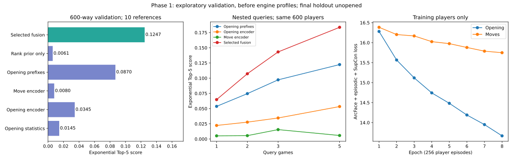

# Phase one — mixed-color 600-way controls

2026-11-11. These are **exploratory model-selection validation scores**, not
Public, not the final holdout, and not directly comparable with the historical
black-only 400-way / 100-reference score. Current official Public is unchanged
at **0.5236602**. Engine rich profiles are still being extracted.

| Method | Exponential Top-5 score |
| --- | ---: |
| Opening-location statistics + train-only Fisher weights, centroid | 0.014485 |
| Opening-statistic encoder, selected log-mean-exp game matching | 0.034506 |
| Both-player move Transformer, selected centroid | 0.008005 |
| D8-invariant exact opening prefixes + reference IDF | 0.086996 |
| Cleanly retrained C2 raw ordinal rank branch, rank affinity alone | 0.006096 |
| Validation-selected prefix / opening encoder / rank / sequence fusion | **0.124733** |

Prefix-only player-bootstrap 95% interval: [0.070099, 0.104164]. The observed
fusion-minus-prefix difference is +0.037736, paired interval
[+0.024895, +0.051394]. **The fusion weights were selected on these players**;
that interval does not account for selection and is not independent proof.
The final 600-player cohort remains unopened for score evaluation.

The selected fusion uses candidate-row standardized scores and weights:
prefix 1.0, opening encoder 2.0, rank prior 1.0, sequence encoder 0.5.
A fixed, two-pass search used a global weight grid, not different tuning per
query count. Even weak standalone branches can help break prefix-score ties;
this is not evidence that the full rank-prediction system has been evaluated.

## What the first results show

- Fine opening choices contain useful identity signal beyond coarse spatial
  counts. Among 3,000 validation query games, 991 match one of their true
  player's references at four moves, 63 at eight moves, four at sixteen moves,
  and none at 32 or 64 moves. A D8 comparison found no same-player query /
  reference pair that is a truncated or rotated duplicate of at least
  32 moves. These are diagnostics, not an additional selection criterion.
- Training a raw Transformer for this budget is not sufficient: its standalone
  score is below the cheap opening controls. This does not establish that all
  longer or stronger sequence models fail. Both encoder controls used eight
  epochs of 256 sampled-player episodes, with ArcFace + episodic + SupCon.
- Game-to-game aggregation is representation-dependent. For untrained opening
  statistics, centroid 0.014485 exceeds pair mean 0.012742, top-three 0.010147
  and log-mean-exp 0.009948. For the learned opening encoder, validation selects
  log-mean-exp. Do not replace all centroids without an ablation.
- The C2 raw rank branch trained on 98,080 games, reserving 4,481 games from
  300 internal training players for rank calibration. Epoch eight / temperature
  1.5 minimizes inner NLL (2.219947). Existing C2 checkpoints were not reused
  because their training identities could overlap this new style validation.
  No hard pruning was performed.

## Audit and limitations

Train / style-validation / final identities are disjoint. Full move-content
hash intersections are zero even when HD differs. Each evaluation cohort has
600 players, ten references and 1/2/3/5-game queries, with nested queries
clustered by player for bootstrap. Training sources are the authorized v1.1
CSV files; all million rows were checked against cached IDs/colors/ranks.

Nonzero HD occurs in 207,390 games. The engine experiment deliberately keeps
the existing moves-only Japanese 6.5-komi proxy; actual rules and missing
initial positions are not inferred. The early pre-audit run is archived;
after strengthening the fingerprint, the split indices stayed identical and
the controls were rerun. Existing engine shards were reused only after input
CSV bytes, row-index bytes and engine metadata compared equal.

Early per-query-color diagnostics are in
`production/open_set_v2_20261111/phase1_color_subgroups.json`. Aggregate JSON,
checkpoint selections, normalization, score matrices and training histories
stay in that same experiment directory. Only code, aggregate records and the
figure are tracked. The production 0.5236602 submission has not been changed.

## Still required

Complete engine extraction, frozen rich-profile baseline, open-set 512D/1024D
fits and ensemble; evaluate learned game-pair scoring and its ablation;
reselect complete fusion on validation; lock it; evaluate the final cohort
once; report paired uncertainty and generalization limitations. No gain over
the production method or new official submission is claimed yet.
