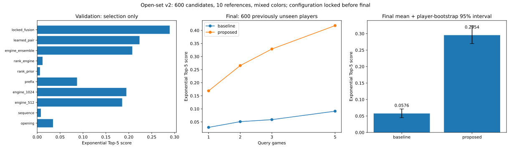

# Completed mixed-color open-set experiment

All five planned directions were evaluated. These are training-only proxy results, **not a new Public score**. The production Public submission remains **0.5236602**, and Private is unknown.



## Fixed protocol and final result

Training: 6,807 players after reserving separate 600-player validation and final cohorts. Player and full move-content hash overlaps are zero. Each evaluation pool has 600 candidates, ten references each, and 2,400 nested queries balanced across 1/2/3/5 games. Confidence intervals bootstrap players, not questions.

The 120,561-game engine cache contains up to sixteen games per training player plus both evaluation cohorts. Extracting final features did not fit any model or access final retrieval outcomes. All preprocessing, class supervision and pair-model fitting used training players. Validation selected models and fusion. Serialized inference replay passed before the configuration was sealed.

| Locked final method | Exponential Top-5 | Player-bootstrap 95% CI |
| --- | ---: | --- |
| baseline | 0.057627 | [0.044899, 0.071281] |
| proposed | 0.295403 | [0.269706, 0.323645] |

Paired difference: **+0.237775**, 95% interval [+0.211479, +0.265015].

The baseline is the predeclared training-normalized, Fisher-weighted rich-profile centroid method. The proposed recipe is selected entirely before final. Neither result is the historical black-only 400-way / 100-reference proxy or the mixed-pool official leaderboard.

| Final query games | Baseline score | Proposed score | Proposed Top1 | Proposed Top5 |
| ---: | ---: | ---: | ---: | ---: |
| 1 | 0.029311 | 0.168913 | 14.33% | 28.17% |
| 2 | 0.051156 | 0.265539 | 22.50% | 41.67% |
| 3 | 0.058877 | 0.328821 | 28.00% | 52.33% |
| 5 | 0.091165 | 0.418339 | 36.50% | 63.33% |

## Validation ablations

These results were used for selection, so their gains and intervals are exploratory; the fixed final comparison above is the confirmation.

| Source / selected aggregation | Validation score |
| --- | ---: |
| opening | 0.034506 |
| sequence | 0.008005 |
| engine_512 | 0.185557 |
| engine_1024 | 0.194671 |
| prefix | 0.086996 |
| rank_prior | 0.006096 |
| rank_engine | 0.011674 |
| engine_ensemble | 0.207629 |
| learned_pair | 0.223484 |
| locked_fusion | 0.289407 |

The two style encoders used the established 9,198-dimensional KataGo/HumanSL/ownership profiles, 512D and 1024D normalized outputs, 32 epochs of 256 player episodes, ArcFace + SupCon + episodic matching. Tiny training libraries use distinct available games; singletons contribute ArcFace only. Final references always number ten.

Pair fitting freezes both encoders, mines natural Top-20 from synthetic 600-way training pools, and compares first-branch, second-branch and both-branch local matching features. Stage-one misses are recorded and never forced into the Top-20. Selected family: `b`, blend 0.75.

| Pair feature family | Dimensions | Validation score | Blend |
| --- | ---: | ---: | ---: |
| a | 20 | 0.219244 | 0.75 |
| b | 20 | 0.223484 | 0.75 |
| both | 33 | 0.221518 | 0.75 |

A fresh C2 raw-move ordinal rank control and a stronger three-seed C2 decision-Transformer rank prior were tested. The latter adapts the 128D / three-layer ordinal architecture to 64x41 cached decisions. It is not the full C1+C2 rank ensemble. Both exclude style-validation/final identities; 300 inner training players select and calibrate rank models. No hard candidate pruning is used.
Engine-rank inner NLL: 1.546575; temperature: 0.75.

## Locked fusion

```json
{
  "learned_pair": 1.0,
  "engine_512": 0.05,
  "opening": 0.1,
  "prefix": 0.1,
  "rank_engine": 1.0,
  "sequence": 0.05
}
```

## Findings and next improvements

- Per-game engine features and cross-game matching have separate ablation records. Do not attribute the complete fused gain to the reranker alone. A zero-strength reranker remained a valid selection.
- Exact symmetry-invariant opening-prefix matching complements coarse statistics. The first raw sequence control was weak at its eight-epoch budget; this does not reject stronger or board-conditioned sequence models in general.
- Query-count and query-color subgroup results are stored in the final JSON. Any remaining one-game weakness should first be addressed through per-game representation and Stage1 Recall@20; a Top-20 reranker cannot recover a player outside its pool.
- Future priorities: rank-matched hard negatives, explicitly cross-color positives, and stronger calibrated rank models. Evaluate changes on a new player-disjoint cohort, with encoders retrained to exclude it. Do not tune further on the now-reported final players.

## Generalization limits and reproducibility

The held-out population requires at least fifteen games and five in each color; this activity/color restriction and nested-query sampling differ from the real leaderboard. Strict game-content deduplication also removes shared-opponent records. This result confirms only the fixed sampled proxy, not an official improvement.

207,390 source games have nonzero HD. The inherited engine representation is a moves-only Japanese 6.5-komi proxy; initial stones and actual komi are not guessed. Representation artifacts and source distribution shift remain limitations.

Artifacts: `production/open_set_v2_20261111/` contains audits, source/model hashes, normalization, complete histories, pair ablations, validation replay, locked_configuration.json, final scores and replayable final_results.json. Source, aggregate documentation and this figure are tracked; data and weights are not.

No new competition upload is claimed, and the 0.5236602 submission was not replaced. Python checks and invariant tests must pass before commit. Existing local Git hooks are used; the original Redmine infra document was unavailable in this session.
