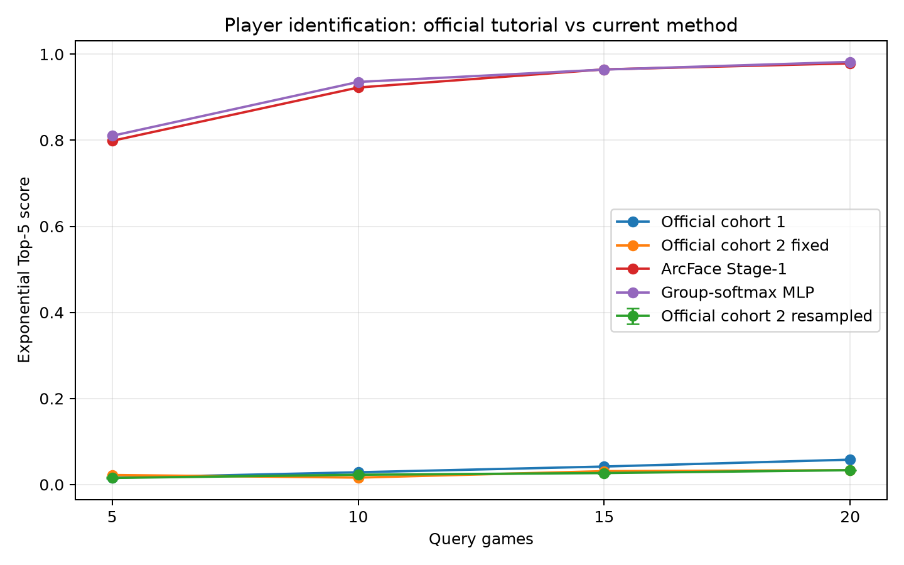
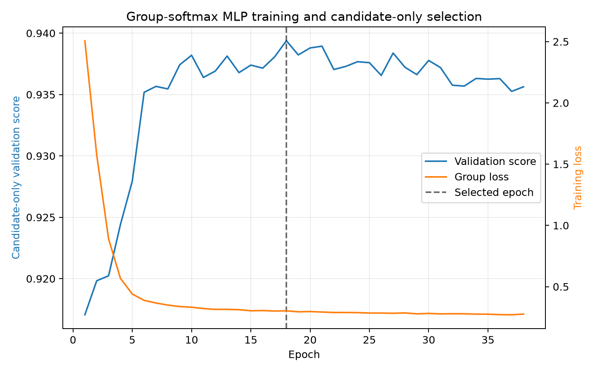

# Hard-negative reranker results

## Scope

This experiment keeps the existing 512D/1024D ArcFace ensemble frozen and
reranks only its Top-20 candidates. It does not modify or share outputs with
the official tutorial reproduction under `aicup_tutorial_review`.

Development uses only the candidate library. ArcFace development embeddings
are fit from 80 reference games per player; the other 20 games supply
synthetic 5/10/15/20-game queries. Query owners are split 320/80 between
reranker train and validation. Candidate identity is never a feature. The
independent query cohort is not used to fit the model or select weights.

## Features and model

- Frozen Stage-1 512D, 1024D, and blended cosine scores
- Stage-1 rank and score gaps
- Sixteen 1024D query-game-to-candidate-game distribution statistics
- Top-20 hard negatives
- Histogram gradient boosting, 50 iterations, 7 leaves, 63 bins
- Two synthetic queries per player and query size in this screening run

## Results

| Method | Candidate-only validation | Independent proxy | Delta vs Stage-1 |
|---|---:|---:|---:|
| Frozen Stage-1 | 0.9327363 | 0.9161533 | - |
| Global reranker weight 0.2 | 0.9332825 | **0.9173711** | **+0.0012178** |
| Per-size validation-selected weights | **0.9341365** | 0.9171257 | +0.0009724 |
| Group-softmax MLP | 0.9393817 | **0.9230399** | **+0.0068866** |

The group-softmax MLP is the current best independent result. Its per-size
independent scores are:

| Query games | Stage-1 | Reranked | Delta |
|---:|---:|---:|---:|
| 5 | 0.7986364 | 0.8102983 | +0.0116619 |
| 10 | 0.9225603 | 0.9355215 | +0.0129612 |
| 15 | 0.9646764 | 0.9642254 | -0.0004510 |
| 20 | 0.9787401 | 0.9821146 | +0.0033745 |

Stage-1 was reproduced exactly at 0.9161533072 in both reranker runs. This is
an important integrity check: the measured delta is against the preserved
best system, rather than a newly approximated baseline.

The per-size run selected weights `{5: 0.2, 10: 0.4, 15: 0.0, 20: 0.0}` using
candidate-only validation. Although it improved validation more, it did not
beat the simpler first run on the independent cohort, so it is retained as an
ablation rather than promoted as the best result.

## Interpretation

The group-aware objective produced a materially larger gain than independent
binary pair classification, especially for 5- and 10-game queries. Top-20
Stage-1 recall is 0.993125 on the independent cohort, so only 0.6875% of
questions are fundamentally unrecoverable by this reranker. Candidate-only
validation selected epoch 18 and neural weight 1.0. The independent cohort was
then evaluated once; it was not used for fitting, early stopping, or weight
selection. Further tuning should use a new outer split or cross-fitting rather
than repeatedly optimizing against this same independent result.

## Artifacts

- `artifacts/frozen_game_embeddings.npz`: reproducible development/final game
  embeddings for all six ArcFace models
- `results/group_softmax_mlp.json`: group-aware MLP, current best
- `results/first_reranker.json`: global-weight histogram baseline
- `results/per_count_reranker.json`: query-size-specific blend ablation
